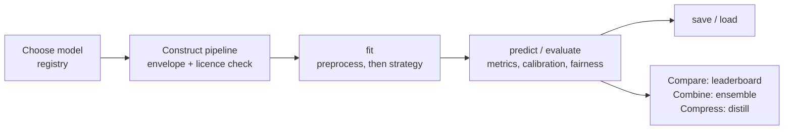

# Basic Concepts

The vocabulary every other page assumes. Four objects, two tasks, three strategies.

## `TabularPipeline`: the object you instantiate

```python
TabularPipeline(
    model_name="TabICL",            # any registry name or alias
    task_type="classification",     # or "regression"
    tuning_strategy="inference",    # "inference" | "finetune" | "peft"
    tuning_params={...},            # epochs, learning_rate, peft_config, finetune_mode ...
    processor_params={...},         # overrides for the DataProcessor
    model_params={...},             # passed to the model constructor
)
```

It owns a `DataProcessor`, a `TuningManager` and the model, and exposes the scikit-learn
verbs: `fit`, `predict`, `predict_proba`, `evaluate`, `save`, `load`. Regression adds
`predict_quantiles` and `predict_intervals`. Three keyword-only arguments control the
guards: `envelope_mode`, `license_mode` and `cache`. The full signature is on the
[TabularPipeline](../user-guide/pipeline.md) page.

## `DataProcessor`: preprocessing that depends on the model

Tabular foundation models disagree about input. TabPFN wants integer-encoded categoricals
and tolerates NaN; ConTextTab wants the raw strings because it embeds them; Mitra wants no
NaN at all; Kumo, LimiX-2 and TabAbax run their own preprocessing inside the model and
want the frame untouched. `DataProcessor` resolves this per model through a preprocessor
key in the registry (`tabpfn_special`, `contexttab_special`, `kumo_special` and so on), so
you pass the same DataFrame every time. You can still override imputation, scaling and
encoding with `processor_params`. See [Data Processing](../user-guide/data-processing.md).

## `TuningManager`: the strategy dispatcher

`fit()` hands the preprocessed data and the model to the `TuningManager`, which runs the
chosen strategy:

| Strategy | What happens in `fit()` | When |
|---|---|---|
| `inference` | Nothing trains. The training rows become the in-context support set. | Baselines, small data, no GPU. |
| `finetune` | Every parameter updates. Modes: `meta-learning` (episodes), `sft` (one split), `turn_by_turn` (regression), `native` (the vendor's loop). | You have a GPU and more than a few thousand rows. |
| `peft` | LoRA adapters train; the base weights stay frozen. | Same gains as `finetune` at a fraction of the memory. |

Each model declares which strategies and modes it supports; the registry refuses the rest
before anything loads. See [Tuning Strategies](../user-guide/tuning-strategies.md).

## The registry: facts about a checkpoint without loading it

`tabtune.registry` is a torch-free table of `ModelSpec` records. Each one carries the
model's tasks, strategies, fine-tuning modes, a `CapabilityEnvelope` (class, feature, row
and cell limits; whether it reads NaN, text or categoricals natively) and a `LicenseSpec`
for the weights.

```python
from tabtune.registry import list_models, get_model_spec

[s.name for s in list_models(task="regression", strategy="peft", commercial_ok=True)]
get_model_spec("Kumo").license.name     # 'OpenMDW-1.1 (weights) / Apache-2.0 (code)'
```

The pipeline consults it in its constructor, which is why a licence problem or a class-count
mismatch fails in milliseconds and not after a multi-gigabyte download. See
[Model Registry](../user-guide/registry.md).

## Tasks

`classification` (binary and multiclass) and `regression`. The registry says which models
support which; TabICL, Orion-MSP and Orion-BiX are classification only. Time
series has its own pipeline and its own tasks (forecasting, anomaly detection, imputation,
embedding); see [Time Series](../timeseries/overview.md).

## In-context learning, in one paragraph

Most models here are in-context learners. They were pretrained on millions of synthetic
tables to predict query rows given labelled support rows, in a single forward pass. At
inference, your training set is the support set and your test rows are the queries. No
weights change. Fine-tuning these models means training on episodes that look like that
forward pass: a support set and a query set sampled from your data. That is what
`finetune_mode="meta-learning"` does, and it is why the support size, the query size and
whether the episode resembles the inference context all matter. The
[Validated Fine-Tuning](../user-guide/fine-tuning.md) page explains how the newer loop
keeps the result at least as good as zero-shot.

## The lifecycle



## Next steps

- **[User Guide Overview](../user-guide/overview.md)**: which page to open for what you
  are trying to do.
- **[Models](../models/overview.md)**: the capability matrix.
