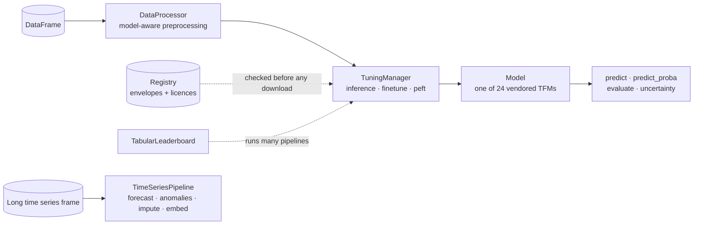

---
hide:
  - navigation
  - toc
---

<div class="tt-hero" markdown>


# One API for <em>tabular</em> foundation models { .tt-hero-title }

<p class="tt-tagline">
TabTune runs and fine-tunes 24 tabular foundation models and 11 time series foundation
models behind one scikit-learn style pipeline: <code>fit</code>, <code>predict</code>,
<code>evaluate</code>, <code>save</code>, <code>load</code>. Preprocessing, training loops
and licence checks are the library's job, not yours.
</p>

[Get started](getting-started/installation.md){ .md-button .md-button--primary }
[View on GitHub](https://github.com/Lexsi-Labs/TabTune){ .md-button }

<p class="tt-chips">
<span>v0.2.2</span>
<span>Python 3.10+</span>
<span>PyTorch 2.7+</span>
<span>24 tabular models</span>
<span>11 time series models</span>
<span>MIT code, per-checkpoint weight licences</span>
</p>

</div>



A tabular foundation model (TFM) is a network pretrained on synthetic tables that predicts a
new table's targets in context, with no gradient step. TabTune vendors the model code of every
supported checkpoint, so one `pip install -e .` gives you TabPFN, TabICL, Mitra, Orion, Kumo
and the rest without installing their packages, and the same `TabularPipeline` call drives
all of them.

There are two parts:

1. **The tabular pipeline.** `DataProcessor` prepares the frame the way the chosen model
   expects it, `TuningManager` runs zero-shot inference, full fine-tuning or LoRA, and the
   torch-free registry checks class counts, feature counts and weight licences before a
   checkpoint is downloaded. Around it sit a leaderboard, six ensembling strategies,
   distillation into GBDT or MLP students, conformal uncertainty, shift-aware evaluation
   and a causal inference module.
2. **The time series pipeline**, added in 0.2.1. Same pattern, eleven vendored forecasters
   plus every tabular model as a forecaster and five statistical baselines. Forecasting,
   anomaly detection, imputation and embeddings from one fitted model.

<div class="grid cards" markdown>

-   :material-table-large:{ .lg .middle } **24 tabular models, one call**

    ---

    TabPFN v2 to v3.5, TabICL, Orion-MSP, Orion-BiX, Mitra, ConTextTab, TabDPT,
    LimiX, TabFM, xRFM, iLTM, EXAONE, Causilo, TabLDM, Kumo. See [Models](models/overview.md).

-   :material-tune-vertical:{ .lg .middle } **Three tuning strategies**

    ---

    `inference` (zero-shot), `finetune` (episodic, SFT or native) and `peft` (LoRA on the
    layers that matter). See [Tuning Strategies](user-guide/tuning-strategies.md).

-   :material-shield-check-outline:{ .lg .middle } **Checks before downloads**

    ---

    A capability envelope and a weight licence per checkpoint, queried in milliseconds.
    `license_mode="commercial"` refuses research-only weights. See
    [Model Registry](user-guide/registry.md).

-   :material-chart-timeline-variant:{ .lg .middle } **Time series**

    ---

    Chronos, Chronos-Bolt, Chronos-2, TimesFM 3, Toto 1 and 2, TiRex, TiRex-2, Time-MoE,
    Timestral and T0, with conformal intervals, covariates and backtesting. See
    [Time Series](timeseries/overview.md).

-   :material-chart-bell-curve-cumulative:{ .lg .middle } **Uncertainty you can ship**

    ---

    Split conformal prediction sets and intervals, temperature recalibration and one
    report with ECE, coverage and set sizes. See [Uncertainty](user-guide/uncertainty.md).

-   :material-scale-balance:{ .lg .middle } **Compare, combine, compress**

    ---

    `TabularLeaderboard` ranks models and strategies, `TabularEnsemble` combines them,
    `TabDistiller` turns a teacher into a LightGBM or MLP student.

</div>

## Start here

- **[Installation](getting-started/installation.md)**: one clone and one `pip install`,
  plus the optional extras.
- **[Quick Start](getting-started/quickstart.md)**: fit, evaluate, save and reload a
  pipeline on an OpenML dataset.
- **[Basic Concepts](getting-started/basic-concepts.md)**: the four objects every page
  assumes you know.
- **[Features](features.md)**: every capability on one page, each linked to the guide
  and the example that runs it.
- **[Models](models/overview.md)**: the capability matrix, the licence table and a page
  per model.
- **[Known Issues](community/known-issues.md)**: what does not work yet, in plain words.
  Read it before assuming a documented path runs end to end on your hardware.

## Installation and first run

```bash
git clone https://github.com/Lexsi-Labs/TabTune.git
cd TabTune
pip install -r requirements.txt
pip install -e .
```

```python
from tabtune import TabularPipeline

pipe = TabularPipeline(model_name="TabICL", task_type="classification", tuning_strategy="inference")
pipe.fit(X_train, y_train)
print(pipe.evaluate(X_test, y_test))
```

Swap `"TabICL"` for any name in `tabtune.registry.list_model_names()` and nothing else
changes.

## Support

- **GitHub Issues**: [report bugs and request features](https://github.com/Lexsi-Labs/TabTune/issues)
- **Discord**: [Lexsi Labs](https://discord.gg/dSB62Q7A)
- **Security**: see [Security](community/security.md) for how to report a vulnerability
- **Email**: [hello@lexsi.ai](mailto:hello@lexsi.ai)

## Citation

If you use TabTune in your research, please cite:

```bibtex
@misc{tanna2025tabtuneunifiedlibraryinference,
      title={TabTune: A Unified Library for Inference and Fine-Tuning Tabular Foundation Models},
      author={Aditya Tanna and Pratinav Seth and Mohamed Bouadi and Utsav Avaiya and Vinay Kumar Sankarapu},
      year={2025},
      eprint={2511.02802},
      archivePrefix={arXiv},
      primaryClass={cs.LG},
      url={https://arxiv.org/abs/2511.02802},
}
```

## Contact

<div align="center" markdown>

<a href="https://lexsi.ai/">


</a>

<https://www.lexsi.ai>

Paris 🇫🇷 · Mumbai 🇮🇳 · London 🇬🇧

</div>
