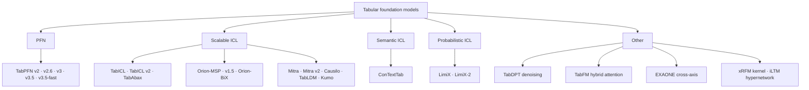

# Models

TabTune runs 24 tabular foundation models from nine architectural families behind one
API. This page compares them on the axes that decide a choice: what they can do, what they
refuse, and whether you are allowed to ship them. Each name links to a page with the
architecture, the model parameters, the fine-tuning parameters and the limits.

!!! tip "Do not hardcode this list"
    The registry is the source of truth and is queryable at runtime. The tables below were
    generated from it.
    ```python
    from tabtune.registry import list_model_names, list_models, models_dataframe
    list_model_names()
    models_dataframe()
    [s.name for s in list_models(task="regression", strategy="peft", commercial_ok=True)]
    ```

## Families



Every model except xRFM is an in-context learner: it reads your training rows as context
and predicts the test rows in one forward pass. xRFM is a kernel method that trains from
scratch, which makes it the one model with no weights to download.

## Strategies and modes

`*` marks a strategy the registry flags as experimental.

| Model | Family | Strategies | Fine-tuning modes |
|---|---|---|---|
| [TabPFN v2](tabpfn.md) (`TabPFN`) | PFN (Prior Labs) | classification: `finetune`, `inference`, `peft`*; regression: `finetune`, `inference` | `meta-learning`, `sft`, `turn_by_turn` |
| [TabPFN v2.6](tabpfnv26.md) (`TabPFNv26`) | PFN (Prior Labs) | classification: `finetune`, `inference`; regression: `finetune`, `inference` | `meta-learning`, `native`, `sft`, `turn_by_turn` |
| [TabPFN v3](tabpfnv3.md) (`TabPFNv3`) | PFN (Prior Labs) | classification: `finetune`, `inference`, `peft`; regression: `finetune`, `inference` | `meta-learning`, `native`, `sft`, `turn_by_turn` |
| [TabPFN v3.5](tabpfnv35.md) (`TabPFNv35`) | PFN (Prior Labs) | classification: `finetune`, `inference`, `peft`; regression: `finetune`, `inference` | `meta-learning`, `native`, `sft`, `turn_by_turn` |
| [TabPFN v3.5-fast](tabpfnv35.md) (`TabPFNv35Fast`) | PFN (Prior Labs) | classification: `finetune`, `inference`, `peft`; regression: `finetune`, `inference` | `meta-learning`, `native`, `sft`, `turn_by_turn` |
| [Causilo](causilo.md) (`Causilo`) | Scalable ICL (Nums AI) | classification: `finetune`, `inference`, `peft`; regression: `finetune`, `inference`, `peft` | `meta-learning` |
| [TabLDM](tabldm.md) (`TabLDM`) | Scalable ICL (Xiaomi) | classification: `finetune`, `inference`, `peft`; regression: `finetune`, `inference`, `peft` | `meta-learning` |
| [TabICL](tabicl.md) (`TabICL`) | Scalable ICL (Inria Soda) | classification: `finetune`, `inference`, `peft`; regression: no | `meta-learning`, `sft` |
| [TabICLv2](tabiclv2.md) (`TabICLv2`) | Scalable ICL (Inria Soda) | classification: `finetune`, `inference`; regression: `finetune`, `inference` | `meta-learning`, `sft`, `turn_by_turn` |
| [Orion-MSP](orion-msp.md) (`OrionMSP`) | Scalable ICL (Lexsi Labs) | classification: `finetune`, `inference`, `peft`; regression: no | `meta-learning`, `sft` |
| [Orion-MSP v1.5](orion-msp-v15.md) (`OrionMSPv1.5`) | Scalable ICL (Lexsi Labs) | classification: `finetune`, `inference`, `peft`; regression: no | `meta-learning`, `sft` |
| [Orion-BiX](orion-bix.md) (`OrionBix`) | Scalable ICL (Lexsi Labs) | classification: `finetune`, `inference`, `peft`; regression: no | `meta-learning`, `sft` |
| [Mitra](mitra.md) (`Mitra`) | Scalable ICL (AWS) | classification: `finetune`, `inference`, `peft`; regression: `finetune`, `inference` | `meta-learning`, `sft`, `turn_by_turn` |
| [Mitra v2](mitrav2.md) (`MitraV2`) | Scalable ICL (AWS) | classification: `finetune`, `inference`, `peft`; regression: `finetune`, `inference` | `meta-learning`, `sft`, `turn_by_turn` |
| [ConTextTab](contexttab.md) (`ContextTab`) | Semantic ICL (SAP) | classification: `finetune`, `inference`, `peft`*; regression: `finetune`, `inference` | `sft`, `turn_by_turn` |
| [TabDPT](tabdpt.md) (`TabDPT`) | Denoising (Layer 6) | classification: `finetune`, `inference`, `peft`; regression: `finetune`, `inference` | `meta-learning`, `sft`, `turn_by_turn` |
| [LimiX](limix.md) (`Limix`) | Probabilistic ICL (Stable AI) | classification: `inference`; regression: `finetune`, `inference` | `turn_by_turn` |
| [Kumo Tabular](kumo-tabular.md) (`KumoTabular`) | Scalable ICL (NVIDIA) | classification: `finetune`, `inference`, `peft`; regression: `finetune`, `inference`, `peft` | `meta-learning` |
| [LimiX-2](limixv2.md) (`LimiXv2`) | Probabilistic ICL (Stable AI) | classification: `finetune`, `inference`, `peft`; regression: `finetune`, `inference`, `peft` | `meta-learning` |
| [TabAbax](tababax.md) (`TabAbax`) | Scalable ICL (BaiRong) | classification: `finetune`, `inference`, `peft`; regression: `finetune`, `inference`, `peft` | `meta-learning` |
| [TabFM](tabfm.md) (`TabFM`) | Hybrid-attention ICL (Google) | classification: `finetune`, `inference`, `peft`; regression: `finetune`, `inference` | `meta-learning`, `sft`, `turn_by_turn` |
| [xRFM](xrfm.md) (`XRFM`) | Kernel / feature learning (UC San Diego) | classification: `finetune`, `inference`, `peft`; regression: `finetune`, `inference` | `refine`, `refit` |
| [iLTM](iltm.md) (`ILTM`) | Hypernetwork (iLTM authors) | classification: `finetune`, `inference`, `peft`; regression: `finetune`, `inference` | `meta-learning`, `sft`, `turn_by_turn` |
| [EXAONE Tabular](exaone.md) (`EXAONETabular`) | Cross-axis ICL (LG AI Research) | classification: `finetune`, `inference`, `peft`; regression: `finetune`, `inference` | `meta-learning`, `sft`, `turn_by_turn` |

What the modes mean is on [Tuning Strategies](../user-guide/tuning-strategies.md).
`meta-learning` is the default for classification and `turn_by_turn` for regression
wherever a model offers them; Kumo, LimiX-2, TabAbax, Causilo and TabLDM offer only
`meta-learning`, and the pipeline selects it for you.

## Limits and licences

"Declared limits" are the registry's capability envelope. A soft limit warns, a hard limit
(the class-count ceiling of a fixed head) raises unless `envelope_mode="ignore"`. "None
declared" means the model degrades gracefully rather than refusing; its page says how.
"Reads natively" lists what the model handles inside its own preprocessing, so TabTune
passes it through instead of imputing or encoding.

The **Commercial** column is about the weights, which is what decides whether you can ship.
`license_mode="commercial"` refuses the "no" rows and warns on "unverified".

| Model | Declared limits | Reads natively | Weights | Weight licence | Commercial |
|---|---|---|---|---|---|
| TabPFN v2 | 10 classes; 500 features; 10,000 rows | NaN | [`Prior-Labs/TabPFN-v2`](https://huggingface.co/Prior-Labs/TabPFN-v2) | Prior Labs License (Apache-2.0 + attribution) | yes |
| TabPFN v2.6 | 10 classes; 500 features; 10,000 rows | NaN | [`Prior-Labs/tabpfn_2_5`](https://huggingface.co/Prior-Labs/tabpfn_2_5) | TabPFN-2.6 license (non-commercial) | no |
| TabPFN v3 | 160 classes; 20,000 features; 1,000,000 rows; 200,000,000 cells | NaN | [`Prior-Labs/tabpfn_3`](https://huggingface.co/Prior-Labs/tabpfn_3) | TABPFN-3.0 License v1.0 | no |
| TabPFN v3.5 | none declared | NaN, text, categorical | [`Prior-Labs/tabpfn_3_5`](https://huggingface.co/Prior-Labs/tabpfn_3_5) | tabpfn-3-5-license-v1.0 (non-commercial) | no |
| TabPFN v3.5-fast | none declared | NaN, text, categorical | [`Prior-Labs/tabpfn_3_5`](https://huggingface.co/Prior-Labs/tabpfn_3_5) | tabpfn-3-5-license-v1.0 (non-commercial) | no |
| Causilo | none declared | NaN, categorical | [`nums-ai/causilo`](https://huggingface.co/nums-ai/causilo) | Apache-2.0 code / Causilo License v1.0 weights (non-commercial) | no |
| TabLDM | none declared | NaN, categorical | [`occams/Xiaomi-TabLDM`](https://huggingface.co/occams/Xiaomi-TabLDM) | Apache-2.0 code; weight license conflicting | unverified |
| TabICL | none declared | NaN | [`soda-inria/tabicl`](https://huggingface.co/soda-inria/tabicl) | BSD-3-Clause | yes |
| TabICLv2 | 2,000 features; 500,000 rows | NaN | [`soda-inria/tabicl`](https://huggingface.co/soda-inria/tabicl) | BSD-3-Clause | yes |
| Orion-MSP | none declared | NaN | [`Lexsi-Labs/OrionMSP`](https://huggingface.co/Lexsi-Labs/OrionMSP) | MIT | yes |
| Orion-MSP v1.5 | none declared | NaN | [`Lexsi-Labs/OrionMSP`](https://huggingface.co/Lexsi-Labs/OrionMSP) | MIT | yes |
| Orion-BiX | none declared | NaN | [`Lexsi-Labs/OrionBix`](https://huggingface.co/Lexsi-Labs/OrionBix) | MIT | yes |
| Mitra | 10,000 rows | - | [`autogluon/mitra-classifier`](https://huggingface.co/autogluon/mitra-classifier) | Apache-2.0 | yes |
| Mitra v2 | none declared | - | [`autogluon/mitra-classifier-2`](https://huggingface.co/autogluon/mitra-classifier-2) | Apache-2.0 | yes |
| ConTextTab | none declared | text, categorical | [`SAP/sap-rpt-1-oss`](https://huggingface.co/SAP/sap-rpt-1-oss) | SAP-RPT-1-OSS (research use) | no |
| TabDPT | none declared | - | [`layer6ai-labs/TabDPT`](https://huggingface.co/layer6ai-labs/TabDPT) | see upstream | unverified |
| LimiX | none declared | NaN | [`limix-ldm-ai/LimiX`](https://huggingface.co/limix-ldm-ai/LimiX) | Stable AI Technology License 1.0 (Apache-2.0 + attribution) | yes |
| Kumo Tabular | none declared | NaN, categorical | [`nvidia/Kumo-Tabular`](https://huggingface.co/nvidia/Kumo-Tabular) | OpenMDW-1.1 (weights) / Apache-2.0 (code) | yes |
| LimiX-2 | 10 classes | NaN, categorical | [`stableai-org/LimiX-2`](https://huggingface.co/stableai-org/LimiX-2) | StableAI LimiX License v1.0 (code) / LimiX Non-Commercial License (weights) | no |
| TabAbax | at least 2 rows | NaN, categorical | [`tababax-ai/TabAbax`](https://huggingface.co/tababax-ai/TabAbax) | CC-BY-NC-4.0 (weights) / BSD-3-Clause, MIT and Apache-2.0 (code) | no |
| TabFM | 10 classes; 500 features | - | [`google/tabfm-1.0.0-pytorch`](https://huggingface.co/google/tabfm-1.0.0-pytorch) | TabFM Non-Commercial License v1.0 | no |
| xRFM | none declared | categorical | (none - trained from scratch) | MIT | yes |
| iLTM | 100 classes | categorical | [`dbonet/iLTM`](https://huggingface.co/dbonet/iLTM) | Apache-2.0 | yes |
| EXAONE Tabular | 100 features; 100,000 rows | NaN | [`LG-AI-Research/EXAONE-Tabular`](https://huggingface.co/LG-AI-Research/EXAONE-Tabular) | EXAONE AI Model License Agreement 1.1 - NC | no |

## In one line each

| Model | One line |
|---|---|
| TabPFN v2 | Prior-data fitted network approximating Bayesian inference on synthetic priors. |
| TabPFN v2.6 | Prior Labs release adding a native fine-tuning API with bar-distribution loss. |
| TabPFN v3 | Re-architected PFN: column distribution embedding, row aggregation, then in-context learning over compressed row embeddings. |
| TabPFN v3.5 | Prior Labs' v3.5 PFN. A distinct architecture from v3, and the first release where one multitask checkpoint carries both the classification and the regression head. |
| TabPFN v3.5-fast | The v3.5-fast checkpoint: a separate, smaller-cost model trained alongside v3.5, not a re-export of it. |
| Causilo | Nums AI in-context model: column attention, row mixing and a pooled prediction stage over a fixed pretrained context. Reports rank 1 on TabArena Full for classification, regression and overall. |
| TabLDM | Xiaomi tabular foundation model: dual-stream feature grouping, a lightweight attention residual and a sparse mixture of experts, pretrained only on structural-causal-model synthetic data. Reports rank 1 on OpenML-CTR23 and rank 2 on regression across TALENT, TabArena and BCCO. |
| TabICL | Scalable tabular in-context learning with column-then-row attention. |
| TabICLv2 | Improved column-then-row attention with QASSMax and quantile regression. |
| Orion-MSP | Multi-scale sparse attention for tabular in-context learning. |
| Orion-MSP v1.5 | OrionMSP with stabilized prototype refinement. |
| Orion-BiX | Bi-axial in-context learning for tabular data. |
| Mitra | Mixed synthetic priors with 2D row-and-column attention (AWS). |
| Mitra v2 | Second-generation Mitra checkpoint on the same 2D row-and-column attention architecture (AWS). Shares TabTune's vendored Tab2D with Mitra v1; only the weights differ. |
| ConTextTab | Semantics-aware in-context learning with modality-specific embeddings. |
| TabDPT | Denoising pre-training transformer with retrieval-based context. |
| LimiX | Likelihood-based mixture modelling with uncertainty-aware inference. |
| Kumo Tabular | NVIDIA Kumo Tabular (28M-215M parameters): interleaved column/row encoder with induced set attention and Fourier cell embeddings, then an in-context learning transformer with length-aware attention temperature. Pretrained on synthetic tables only. |
| LimiX-2 | 400M-parameter LimiX-2: contextual mechanism network pretrained with context-conditional masked modelling on SCM priors; one model for classification, regression and imputation. |
| TabAbax | BaiRong TabAbax: a TabICLv2-derived in-context model with learnable Fourier feature embeddings, a row interaction that keeps every feature token and a second column/row interaction round before the ICL head. Eight dataset-view ensemble members by default. |
| TabFM | Google Research hybrid attention: alternating row/column blocks, row compression to CLS tokens, then a causal ICL transformer. |
| xRFM | Recursive Feature Machine: a kernel method that learns features via the average gradient outer product, partitioned by a tree and solved with EigenPro so it scales to large tabular data. |
| iLTM | Integrated Large Tabular Model: a hypernetwork generates MLP ensembles conditioned on dataset embeddings, combining GBDT tree embeddings with retrieval over the training set. |
| EXAONE Tabular | LG AI Research in-context learner built on the Cross-axis Summary Transformer (CAST): per-row feature summaries and per-column row summaries exchanged across both table axes under SSMax-normalised attention. Only the classification checkpoint is published; regression needs a locally supplied weights file. |

## Choosing

The short version, in the order the questions usually come:

1. **More than ten classes?** TabPFN v3 (160), iLTM (100), or a model with ECOC
   decomposition (EXAONE, Causilo, Mitra, Kumo). TabAbax and LimiX-2 handle more than
   ten at inference but refuse to fine-tune above it.
2. **Text or datetime columns?** ConTextTab and TabPFN v3.5 read them natively. Everything
   else sees an encoding.
3. **More than 10,000 rows?** TabPFN v3 and v3.5, TabICL v2, Kumo, TabDPT, EXAONE
   (subsamples to 100,000). TabPFN v2 and v2.6 degrade past 10,000.
4. **Need to ship commercially?** Filter with `list_models(commercial_ok=True)`. Mitra,
   TabICL, the Orion family, Kumo, iLTM, xRFM and TabPFN v2 clear. TabPFN v2.6 and later,
   TabFM, ConTextTab, EXAONE, LimiX-2, TabAbax and Causilo do not.
5. **No GPU?** Inference works on CPU for the small models (TabPFN v2, TabICL, Orion-MSP,
   EXAONE, Kumo small). Fine-tuning anything on CPU is slow.
6. **Can't tell?** Run a [Leaderboard](../user-guide/leaderboard.md) over the candidates on
   your own split. It takes one call and answers the question for your data rather than
   for a benchmark.

[Model Selection](../user-guide/model-selection.md) goes through this in depth.
