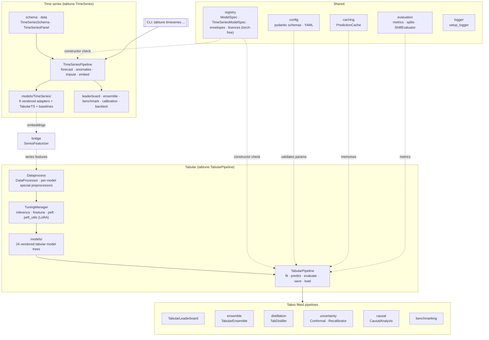

# Architecture

TabTune is one package, `tabtune`, with two pipelines and a ring of modules that take
fitted pipelines as input. This page is the map of how the pieces fit; the narrative is on
[Features](../features.md) and the [User Guide Overview](../user-guide/overview.md).

## The system map

## Package by package

| Package | What lives there |
|---|---|
| `tabtune/TabularPipeline/` | `TabularPipeline` and `TabularLeaderboard`. The pipeline owns the processor, the tuning manager and the model, and exposes the evaluation, calibration, fairness, residual, cross-validation and baseline methods. |
| `tabtune/Dataprocess/` | `DataProcessor`, the regression subpackage, and one `*_preprocessor.py` per model that wants something other than the default imputation, scaling and encoding. The registry's `preprocessor_key` selects it. |
| `tabtune/TuningManager/` | `TuningManager.tune` dispatches on the model class to a strategy implementation. `peft_utils` holds `MODEL_LORA_TARGETS` and the LoRA injector. `episodic_finetune` is the validated driver (implementation in `tabtune/_internal/`). |
| `tabtune/models/` | One vendored tree per model family, each with its own `LICENSE`. TabTune-specific glue sits in a `tabtune_support.py` beside the vendored code, never inside it. `regression/` holds the thin regression wrappers. `TimeSeries/` holds the forecasting adapters. |
| `tabtune/registry/` | `ModelSpec`, `CapabilityEnvelope`, `LicenseSpec`, `MODEL_REGISTRY`, `TS_MODEL_REGISTRY`, the `check_*` functions and the exception hierarchy. Imports no torch. |
| `tabtune/TimeSeries/` | `TimeSeriesPipeline`, schema and panel types, forecast and task result types, leaderboard, ensemble, benchmark, calibration, backtest windows, synthetic data, the `timeseries` CLI group. |
| `tabtune/bridge/` | `SeriesFeaturizer` and `add_series_features`. |
| `tabtune/config/` | Pydantic schemas (`PipelineConfig`, `TuningConfig`, `PeftConfig`, `ProcessorConfig`, `ForecastConfig`...), YAML load and save, `validate_against_registry`. |
| `tabtune/uncertainty/` | `ConformalClassifier`, `ConformalRegressor`, `Recalibrator`, `uncertainty_report`. |
| `tabtune/evaluation/` | Shared metric functions used by the pipeline, the leaderboard and the shift report; `TemporalSplit`, `GroupedSplit`, `StratifiedGroupedSplit`; `ShiftEvaluator`. |
| `tabtune/caching/` | `PredictionCache`, memory or disk, keyed by a fingerprint of the data and the model state. |
| `tabtune/ensemble/`, `tabtune/distillation/`, `tabtune/causal/` | `TabularEnsemble`; `TabDistiller` with LightGBM, XGBoost, CatBoost and MLP students and exporters; `CausalAnalysis` with estimators, identification, refutation and audits. |
| `tabtune/resampling/` | Context and support/query sampling used by the episodic loops. |
| `tabtune/benchmarking/`, `tabtune/data/` | Benchmark suites and result handling; dataset loaders for OpenML, TabArena, TabZilla and TALENT. |
| `tabtune/logger.py`, `tabtune/cli.py`, `tabtune/run.py` | The one logger; the `tabtune` console script; the script entry point. |
| `tabtune/_internal/` | Device resolution, scikit-learn compatibility shims, deprecation helpers, the episodic driver's implementation. Not public. |

## Design rules the code follows

- **Vendor, do not depend.** Model code is copied in with its licence, imports rewritten
  to the vendored path, and otherwise left alone. TabTune's additions live in a
  `tabtune_support.py` next to it. This is why `pip install -e .` is the whole install and
  why a model's upstream release cannot break TabTune overnight.
- **Check before downloading.** The registry is importable without torch and the pipeline
  constructor consults it, so an unsupported task, a refused licence or an impossible class
  count fails before a checkpoint is fetched.
- **Adapt the data to the model, not the user to the model.** The processor key in the
  registry decides what happens to your columns; you pass the same frame to every model.
- **Lazy imports.** `import tabtune` loads nothing heavy. Submodules and model trees import
  on first use.
- **Shared metrics.** The pipeline, the leaderboard, the benchmark CSV and the shift report
  compute numbers through `tabtune.evaluation.metrics`, so they agree by construction.

## Adding a model

The [Contributing](../community/contributing.md) page has the checklist. In short: vendor
the tree under `tabtune/models/<name>/`, write `tabtune_support.py` with an estimator that
accepts TabTune's constructor conventions, add a preprocessor if the default does not fit,
register a `ModelSpec` in `tabtune/registry/catalog.py`, add the dispatch branch in
`TuningManager`, a `MODEL_LORA_TARGETS` entry if LoRA applies, a docs page under
`docs/models/`, and a test that runs on a tiny randomly initialised network without
downloading weights.
