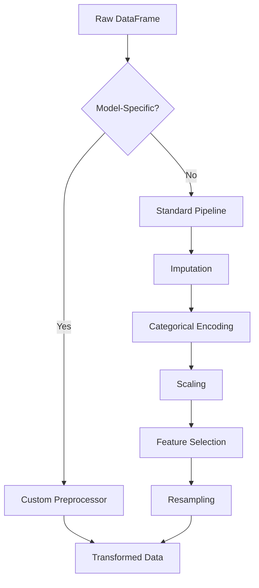

# Data Processing

`DataProcessor` prepares your frame the way the chosen model expects it: imputation, scaling, categorical encoding, feature selection and resampling, decided per model. You pass the same DataFrame every time.

## Overview

The `DataProcessor` integrates two preprocessing pathways:

1. Custom Model-Specific Preprocessing: For models requiring specialized transformations (TabPFN, TabICL, ContextTab, Mitra, TabDPT, OrionMSP, OrionBix).
2. Standard Preprocessing Pipeline: For general tabular models using scikit-learn-compatible transformations.

## Architecture



## Initialization parameters

```python
DataProcessor(
    model_name=None,
    override_types=None,
    imputation_strategy='mean',
    categorical_encoding='onehot',
    scaling_strategy='standard',
    resampling_strategy=None,
    feature_selection_strategy=None,
    feature_selection_k=10,
    model_params=None
)
```

### Parameter reference

| Parameter | Type | Default | Description |
|-----------|------|---------|-------------|
| `model_name` | str | None | Model identifier to trigger custom preprocessing |
| `override_types` | dict | None | Manual column type specifications |
| `imputation_strategy` | str | 'mean' | Strategy for missing value imputation |
| `categorical_encoding` | str | 'onehot' | Categorical encoding method |
| `scaling_strategy` | str | 'standard' | Numerical feature scaling method |
| `resampling_strategy` | str | None | Class imbalance correction method |
| `feature_selection_strategy` | str | None | Feature selection algorithm |
| `feature_selection_k` | int | 10 | Number of features to select |
| `model_params` | dict | None | Additional model-specific parameters |

## Model-aware defaults

When `model_name` is specified, the processor automatically configures optimal preprocessing:

| Model | Categorical Encoding | Special Handling |
|-------|---------------------|------------------|
| **TabPFN** | `tabpfn_special` | Integer encoding, limited feature count |
| **TabICL** | `tabicl_special` | Normalization + shuffling support |
| **OrionMSP** | `orionmsp_special` | Multi-scale prior preprocessing |
| **OrionBix** | `tab_biaxial_special` | Custom biaxial attention preprocessing |
| **TabDPT** | `tabdpt_special` | Context-aware transformations |
| **Mitra** | `mitra_special` | 2D attention preprocessing |
| **ContextTab** | `contexttab_special` | Text embedding integration |

## Standard preprocessing pipeline

### Missing value imputation

Available strategies:

- mean: Replace with column mean (default)
- median: Replace with column median
- iterative: Multivariate imputation using IterativeImputer
- knn: K-Nearest Neighbors imputation

```python
processor = DataProcessor(imputation_strategy='median')
```

### Categorical encoding

Supported methods:

- onehot: One-hot encoding (default, handles unknown categories)
- ordinal: Ordinal encoding with unknown value handling
- target: Target encoding (uses target statistics)
- hashing: Hashing encoder for high-cardinality features
- binary: Binary encoding for memory efficiency

```python
processor = DataProcessor(categorical_encoding='target')
```

### Numerical scaling

Available scalers:

- standard: Standardization (zero mean, unit variance)
- minmax: Min-max normalization to [0, 1]
- reliable: Reliable scaling using median and IQR
- power_transform: Power transformation for normality

```python
processor = DataProcessor(scaling_strategy='robust')
```

### Feature selection

Methods:

- variance: Remove low-variance features
- select_k_best_anova: ANOVA F-test for classification
- select_k_best_chi2: Chi-squared test (requires non-negative features)
- correlation: Remove highly correlated features (threshold=0.9)

```python
processor = DataProcessor(
    feature_selection_strategy='select_k_best_anova',
    feature_selection_k=20
)
```

### Class resampling

Imbalanced data handling:

- smote: Synthetic Minority Over-sampling Technique
- random_over: Random oversampling of minority class
- random_under: Random undersampling of majority class
- tomek: Tomek links removal
- kmeans: Cluster centroids undersampling
- knn: Neighborhood cleaning rule

```python
processor = DataProcessor(resampling_strategy='smote')
```

### get_processing_summary() function

Returns a detailed report of all applied transformations.

```python
summary = processor.get_processing_summary()
print(summary)
```

**Example Output**:
```
--- Data Processing Summary ---

[Standard Preprocessing Pipeline]

1. Imputation (Strategy: 'median')
 - Applied to 12 numerical features: `age`, `salary`, ...

2. Categorical Encoding (Strategy: 'onehot')
 - Applied to 5 categorical features: `city`, `occupation`, ...

3. Scaling (Strategy: 'standard')
 - Applied to 27 features (original numerical + encoded categorical).

4. Feature Selection (Strategy: 'select_k_best_anova')
 - Removed 7 features: `feature_3`, `feature_8`, ...

[Resampling]
 - Strategy: 'smote' applied to the training data.
```

## Custom model preprocessing

For models with special requirements, TabTune automatically loads the appropriate custom preprocessor:

### TabPFN preprocessing
- Converts all features to integer codes
- Limits feature count (max 100)
- Handles categorical and numerical separately

### TabICL preprocessing
- Applies multiple normalization methods
- Supports feature shuffling strategies
- Prepares data for episodic training

### OrionMSP preprocessing
- Multi-scale prior transformations
- Column-then-row attention preparation
- Ensemble view transformations

### OrionBix preprocessing
- Biaxial attention preprocessing
- Custom feature interaction handling
- Similar to TabICL with enhanced interactions

### ContextTab preprocessing
- Generates text embeddings for categorical features
- Integrates semantic information
- Handles mixed-type features

### TabDPT preprocessing
- Context-based transformations
- Supports k-NN context selection
- Prepares permuted features

### Mitra preprocessing
- 2D attention-compatible format
- Row and column embeddings
- Synthetic prior integration

## Usage examples

### Basic standard pipeline

```python
from tabtune import DataProcessor

processor = DataProcessor(
    imputation_strategy='median',
    categorical_encoding='onehot',
    scaling_strategy='standard'
)

# Fit on training data
processor.fit(X_train, y_train)

# Transform training and test data
X_train_processed, y_train_processed = processor.transform(X_train, y_train)
X_test_processed = processor.transform(X_test)
```

### Handling imbalanced data

```python
processor = DataProcessor(
    imputation_strategy='mean',
    categorical_encoding='target',
    scaling_strategy='robust',
    resampling_strategy='smote'
)

# Resampling is applied during fit_transform
X_resampled, y_resampled = processor.fit_transform(X_train, y_train)
```

## Troubleshooting

### "Must call fit() before calling transform()"
**Solution**: Make sure `.fit()` is called on training data before `.transform()`.

### Feature count mismatch after encoding
**Solution**: Use `handle_unknown='ignore'` in encoder or make sure test data has same categories.

### NaN values after transformation
**Solution**: Check imputation strategy; use `'iterative'` for complex missing patterns.

### Memory errors with large datasets
**Solution**: Use `'hashing'` or `'binary'` encoding; avoid one-hot for high cardinality.
