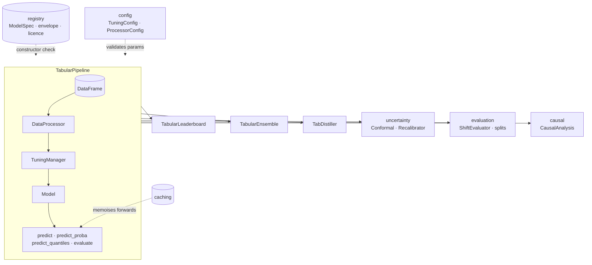

# User Guide Overview

This is the map. [Home](../index.md) and [Features](../features.md) say *that* TabTune runs,
fine-tunes, compares and ships tabular foundation models; this page says how the pieces fit
and which User Guide page to open for what you are trying to do.
[Basic Concepts](../getting-started/basic-concepts.md) covers the vocabulary; this page
builds on it.

## One pipeline, many models

Everything to the right of the pipeline takes fitted pipelines (or anything with
`predict_proba`) as input. Nothing there knows which model is inside, which is the point:
you can swap TabPFN for Kumo and the leaderboard, the conformal wrapper and the distiller
keep working.

The pipeline itself does three things in `fit()`:

1. The registry check already happened in the constructor. Task, strategy and licence
   are confirmed; the envelope is compared against your data's shape, and violations warn
   or raise depending on `envelope_mode`.
2. `DataProcessor.fit_transform` prepares the frame the way this model expects.
3. `TuningManager.tune` runs the strategy. For `inference` that is a no-op beyond storing
   the context; for `finetune` and `peft` it is one of the training loops described on
   [Tuning Strategies](tuning-strategies.md).

## If you want to do X, open page Y

### Run a model and get numbers back: [TabularPipeline](pipeline.md)

The constructor, every method, what `evaluate()` returns for each task, the calibration and
fairness reports, residual analysis, cross-validation and the baseline comparison. The
longest page in the guide and the one the rest assumes you skimmed.

### Control what happens to your columns: [Data Processing](data-processing.md)

Imputation, scaling, encoding, the per-model special preprocessors, and
`processor_params` for when you disagree with the default. Pair it with
[Custom Preprocessing](../advanced/custom-preprocessing.md) if you need your own
transformer in the chain.

### Decide between zero-shot, fine-tuning and LoRA: [Tuning Strategies](tuning-strategies.md)

What each strategy trains, the four `finetune_mode` values, the parameters each accepts,
and a decision table. Then [Validated Fine-Tuning](fine-tuning.md) for how the newer
episodic loop measures itself against zero-shot and refuses to make things worse, and
[PEFT & LoRA](../advanced/peft-lora.md) for the adapter internals.

### Predict a number instead of a class: [Regression](regression.md)

Which models have a native regression head, how the others get one, quantile and interval
prediction, and the regression-specific preprocessing.

### Pick a model: [Model Selection](model-selection.md) and [Models](../models/overview.md)

Rows, columns, classes, text, missing values, licence and hardware, in that order. The
Models section has the capability matrix and one page per model.

### Know what you are allowed to ship: [Model Registry](registry.md)

Capability envelopes, weight licences, `envelope_mode`, `license_mode`, and how to register
a model of your own.

### Compare, combine, compress

- [Leaderboard](leaderboard.md): many configurations on one split, ranked.
- [Ensembling](ensembling.md): six strategies over fitted pipelines.
- [Distillation](distillation.md): a GBDT or MLP student that serves without a GPU.

### Trust the probabilities: [Uncertainty](uncertainty.md)

Split conformal prediction sets and intervals with a coverage guarantee, post-hoc
recalibration, and the one-call `uncertainty_report()`.

### Evaluate the way production will behave: [Shift-Aware Evaluation](shift-evaluation.md)

Temporal, grouped and stratified-grouped splits, and the IID-to-shift gap.

### Estimate a treatment effect: [Causal Inference](causal.md)

`CausalAnalysis` with six estimators, identification, refutation and fairness audits, with a
tabular foundation model as the nuisance learner.

### Make an experiment reproducible: [Typed Configuration](configuration.md)

Pydantic schemas for every knob, YAML round trips, and a registry validation you can run in
CI.

### Stop paying for the same forward pass twice: [Prediction Caching](caching.md)

`cache="memory"` or `"disk"`; what is keyed, what invalidates it.

### See what the library is doing: [Logging](logging.md)

`setup_logger` once, Rich or JSON, rotating files, rank-zero filtering.

### Something broke: [Troubleshooting](troubleshooting.md)

Problem, cause, fix, for the errors people actually hit. Then
[Known Issues](../community/known-issues.md).

## Time series

`TimeSeriesPipeline` is the same pattern over a long-format frame and a `TimeSeriesSchema`.
It has its own section: [Time Series](../timeseries/overview.md).
