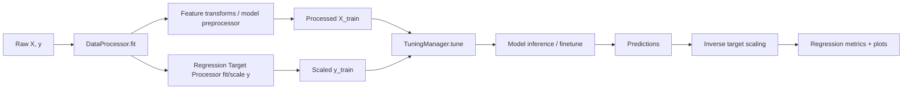

# Regression

Regression uses the same `TabularPipeline` as classification with `task_type="regression"`. What changes underneath: the model wrappers, the preprocessing of the target, the metrics, and the fine-tuning mode default (`turn_by_turn`).

## Introduction

**"Regression mode" in TabTune**

When `task_type="regression"`, TabTune switches:

- **Model wrappers** to regression-specific adapters (e.g., `TabPFNRegressorWrapper`, `TabDPTRegressorWrapper`, `MitraRegressorWrapper`, `LimixRegressorWrapper`, `ConTextTabRegressorWrapper`)
- **Target processing** to regression-specific scaling and (model-specific) target transforms
- **Evaluation** to regression metrics such as RMSE / MAE / R²

Regression mode is activated at pipeline construction time:

```python
from tabtune import TabularPipeline

pipeline = TabularPipeline(
    model_name="Limix",
    task_type="regression",
    tuning_strategy="inference",
)
```

## High-level architecture

### Pipeline flow



## Supported regression models

TabTune regression is implemented via **regression wrappers** that standardize:
- preprocessing expectations
- calling conventions (`fit`, `predict`)
- optional finetune behavior

| Model Name (`model_name`) | Wrapper Class | Default Strategy |
|---|---|---|
| `TabPFN` | `TabPFNRegressorWrapper` | inference |
| `ContextTab` | `ConTextTabRegressorWrapper` | inference / finetune |
| `TabDPT` | `TabDPTRegressorWrapper` | inference/finetune  |
| `Mitra` | `MitraRegressorWrapper` | inference/finetune |
| `Limix` | `LimixRegressorWrapper` | inference/finetune |

## Core API usage

### Inference-only regression

```python
from tabtune import TabularPipeline

pipeline = TabularPipeline(
    model_name="TabPFN",
    task_type="regression",
    tuning_strategy="inference",
)

pipeline.fit(X_train, y_train)
pred = pipeline.predict(X_test)
metrics = pipeline.evaluate(X_test, y_test)

print(metrics["rmse"], metrics["r2_score"])
```

### Regression fine-tuning

TabTune's regression fine-tuning is implemented through `TuningManager` and is currently most explicit for **ContextTab regression** (episodic fine-tuning).

```python
pipeline = TabularPipeline(
    model_name="ContextTab",
    task_type="regression",
    tuning_strategy="finetune",
    tuning_params={
        "device": "cuda",
        "epochs": 1,
        "steps_per_epoch": 200,
        "context_size": 256,
        "query_size": 64,
        "lr": 1e-5,
        "weight_decay": 0.01,
        "clip_grad_norm": 1.0,
        "seed": 42,
    }
)
pipeline.fit(X_train, y_train)
```

If you attempt regression finetuning for a model that is not enabled by the pipeline's regression finetune validation, TabTune raises a clear error.

## Regression metrics & evaluation

TabTune computes **complete** regression metrics during `evaluate()`.

### Standard regression metrics

Returned metrics include:

- `mse`
- `rmse`
- `mae`
- `r2_score`
- additional metrics like median absolute error, explained variance, max error

Example:

```python
results = pipeline.evaluate(X_test, y_test)
print(results)
```

### Residual diagnostics

The pipeline includes utilities for residual analysis and saving plots (where supported):

- residual plots
- error distributions

Use these for debugging calibration and identifying heteroscedasticity.

## Important parameters

Regression-specific parameters are mostly configured through:

- `task_type="regression"` (required)
- `model_params` (model-level behavior)
- `tuning_params` (finetune behavior if enabled)
- `proc_params` / `processor_params` (target scaling & preprocessing)

A few key knobs:

| Parameter | Where | Typical Values | What it does |
|---|---|---|---|
| `task_type` | pipeline | `regression` | switches entire framework |
| `target_scaling_strategy` | processor | `standard`, `minmax`, `reliable`, `power_transform`, `none` | scales y |
| `tuning_strategy` | pipeline | `inference`, `finetune` | regression adaptation mode |
| `context_sampling_strategy` | processor | (see resampling docs) | controls context selection |

## Saving & loading

TabTune's `TabularPipeline` supports persistence via `joblib`:

```python
pipeline.save("regressor.joblib")
loaded = TabularPipeline.load("regressor.joblib")
pred = loaded.predict(X_test)
```

This is the recommended way to package a regression workflow for reuse.

## Troubleshooting

### "RegressionDataProcessor must be fitted before transform"
**Cause:** calling `transform(y)` before `fit(y)` in custom flows.
**Fix:** always call `pipeline.fit(X, y)` before `predict/evaluate`.

### "Regression finetuning is not enabled for model …"
**Cause:** finetune was requested but the model is not enabled by the pipeline's guard.
**Fix:** use `tuning_strategy="inference"` or switch to a supported model (e.g., ContextTab regression finetune).

### Predictions look "scaled"
**Cause:** target scaling is enabled, but inverse scaling wasn't applied in a custom path.
**Fix:** use pipeline APIs (they handle inverse scaling), or manually call `processor.regression_processor_.inverse_transform()` when needed.

## TabTune Regression Data Processing

How TabTune prepares regression data: feature preprocessing, target scaling, and the model-specific regression processors.

It focuses on the code paths used when `task_type="regression"`.

## Overview

In regression mode, TabTune uses a two-layer processing stack:

1. **`DataProcessor`** (`tabtune/Dataprocess/data_processor.py`)
 - orchestrates feature transforms
 - selects and fits a **regression processor** for `y`
 - routes to model-specific preprocessors when needed

2. **Regression processors** (`tabtune/Dataprocess/regression/*`)
 - implement target scaling / transforms
 - implement model-specific regression target encoding where needed

## Regression target scaling

### `RegressionDataProcessor`

Base target scaling is implemented in:

- `tabtune/Dataprocess/regression/base_processor.py`

Supported `target_scaling_strategy`:

| Strategy | Description | When to use |
|---|---|---|
| `standard` | z-score scaling | strong default |
| `minmax` | maps y into [0, 1] | bounded targets |
| `reliable` | reliable scaling vs outliers | heavy-tailed y |
| `power_transform` | stabilize variance / normalize | skewed y |
| `none` | no scaling | already-normalized targets |

Example:

```python
pipeline = TabularPipeline(
    model_name="Mitra",
    task_type="regression",
    processor_params={
        "target_scaling_strategy": "robust"
    }
)
```

### Inverse transform (predictions)

Regression processors support `inverse_transform()` so that:
- the model trains on scaled targets
- predictions are returned in the **original y space**

If you bypass pipeline APIs, make sure you inverse-transform predictions before reporting.

## Model-specific regression processors

`DataProcessor` selects the correct regression processor via a small factory:

- `tabtune/Dataprocess/data_processor.py` → `_get_regression_processor()`

### Available processor implementations

| Model | Processor |
|---|---|
| TabPFN | `TabPFNRegressionProcessor` |
| ContextTab | `ContextTabRegressionProcessor` |
| TabDPT | `TabDPTRegressionProcessor` |
| Mitra | `MitraRegressionProcessor` |
| Limix | `LimixRegressionProcessor` |
| fallback | `RegressionDataProcessor` |

These live in `tabtune/Dataprocess/regression/`.

### ContextTab regression: binning & regression type

ContextTab regression processor supports additional config:

- `regression_type` (default: `l2`)
- `num_regression_bins` (default: `16`)

These are forwarded from `model_params` and used in ContextTab preprocessor/processor construction.

Example:

```python
pipeline = TabularPipeline(
    model_name="ContextTab",
    task_type="regression",
    model_params={
        "regression_type": "l2",
        "num_regression_bins": 32
    }
)
```

## Feature processing in regression mode

Regression mode reuses much of TabTune's standard feature preprocessing stack:

- numeric scaling
- categorical encoding (ordinal/one-hot depending on model/preprocessor)
- missing value handling

Key rule:
- If a **custom preprocessor** is selected for a model, TabTune delegates the feature transform to it.
- Otherwise, TabTune applies standard transforms inferred from column types.

## Practical recommendations

### Choose a target scaling strategy

- Start with `standard`
- Use `reliable` for outlier-prone targets
- Use `power_transform` for strong skew / nonlinear target distributions
- Use `none` only if you know the model expects raw y

### Keep y as 1D

Internally, TabTune reshapes y to fit sklearn scalers.
If you pass a `DataFrame` with multiple regression targets, behavior may be undefined unless the model explicitly supports it.

## Troubleshooting

### "y has wrong shape"
**Fix:** pass a 1D `pd.Series` or 1D numpy array for y.

### "Inverse transform fails"
**Cause:** regression processor not fitted.
**Fix:** make sure `pipeline.fit(X_train, y_train)` ran successfully before calling `predict()`.
